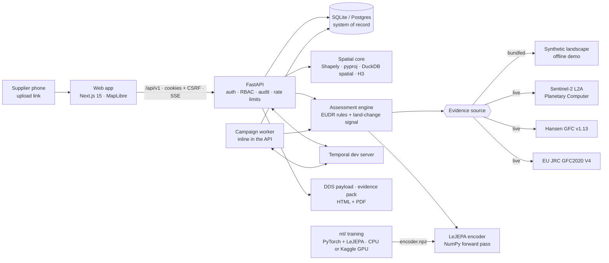

<div align="center">

# Plotline

**EU Deforestation Regulation (EUDR) due diligence, proven plot by plot.**

Plotline helps EU importers and their suppliers abroad prove that every shipment of cocoa, coffee, soy, palm oil, cattle, rubber or wood comes from land that was not deforested after 31 December 2020. It then prepares the due diligence statement the EU requires and the evidence behind it.

[Problem statement](docs/PROBLEM_STATEMENT.md) · [Architecture](docs/ARCHITECTURE.md) · [API contract](docs/API_CONTRACT.md) · [Design decisions](docs/adr/) · [Evaluation](eval/RESULTS.md)

</div>

---

## Why now

The EUDR (Regulation (EU) 2023/1115, as amended by Regulation (EU) 2025/2650) applies from **30 December 2026** for medium and large operators and **30 June 2027** for micro and small ones. From then on, a product may only be placed on the EU market if the operator has done the following:

- holds the **geolocation of every plot** it came from: a point for plots up to 4 ha, a polygon above that, in WGS84 with six decimal places;
- has assessed the risk that any of those plots was deforested after the cut-off;
- has filed a **due diligence statement (DDS)** in the EU information system (TRACES);
- keeps the evidence for **five years**.

Importers sit at the end of long supply chains. Cooperatives aggregate thousands of smallholders. Plot data arrives late, in spreadsheets and phone screenshots. Checking each plot against satellite forest maps by hand does not scale.

The common ways this goes wrong are predictable:

- plot geometry that is missing or invalid;
- unverified product mixed into a verified batch;
- shipment volumes the declared plots could not have grown;
- verdicts nobody can reproduce a year later.

Plotline is built around each of those problems.

| Instead of | Plotline does |
|---|---|
| Spreadsheets of coordinates emailed by suppliers | A supplier upload link (no account) to draw, tap or upload plots, checked against the EUDR geometry rules as they arrive |
| A consultant eyeballing satellite images | An assessment against the **official forest datasets** (EU JRC Global Forest Cover 2020 for the cut-off, Hansen Global Forest Change for loss since 2021), with reasons and before/after imagery |
| A model's opinion as the verdict | A self-trained satellite **land-change signal** that only *raises* attention and sends disagreements to a reviewer, never clears a plot on its own |
| Chasing suppliers by email for weeks | Durable supplier campaigns with reminders, automated checks and reviewer approval, which survive restarts |
| A DDS assembled by hand | The DDS data in the TRACES structure, a human-readable evidence pack (HTML and PDF) and a submission log |

## Features by role

| Role | What they get |
|---|---|
| **Compliance manager** | Readiness against the deadline, shipments that are cleared to ship or blocked (with the failing check), DDS creation and (simulated) submission, evidence packs, organisation settings and members |
| **Sourcing / buying** | Supplier list with readiness, plot import (GeoJSON, KML, CSV), shipments allocated to plots with mass-balance checks, supplier campaigns and upload links |
| **Reviewer** | A review queue of plots where the official data is borderline or the land-change signal disagrees, with forest 2020, loss since 2021 and before/after imagery side by side; decisions are recorded and the original assessment is never overwritten |
| **Supplier / cooperative** | A phone-friendly upload page from a link (no account): draw a plot on the map, enter a point, or upload a file, and see immediately what is missing or invalid |
| **Auditor** | Read access to plots, shipments, statements and the activity log, with a check that the log has not been altered |
| **Owner / executive** | An overview with readiness by supplier, commodity and country, plots at risk, days to the deadline and plain-language insights |

Under the hood, every verdict:

- stores the dataset versions, the rules version and input and result hashes, so the same inputs give the same verdict;
- runs the geometry rules first: precision, self-intersection, overlaps with other plots, plausibility against the declared country, and the 4 ha point limit.

Country risk tiers come from the EU benchmarking (Implementing Regulation (EU) 2025/1093). Shipments are blocked if any of these hold:

- a non-compliant plot is allocated;
- the volume is more than the plots could plausibly yield;
- unreviewed product is mixed into the batch.

## Quick start (offline, no accounts)

You need Python 3.13 and Node 21.7 (see `frontend/.nvmrc`). No Docker, no API keys and no network after setup.

```bash
make setup      # Python venv + API, web app dependencies, Temporal CLI into .tools/, .env from .env.example
make seed       # creates the SQLite database and the demo organisation (synthetic data, offline)
make dev        # Temporal :7233 (UI :8233) · API :8010 · web :3010 (production build on first run)
```

Open http://localhost:3010 and sign in as **`amelie.kraus@northbank.example`** / **`Northbank-Demo-2026`** (owner).

The demo organisation is **Northbank Cocoa & Coffee Imports GmbH** (Hamburg). It contains:

- other roles with the same password: `jonas.weber@` (compliance manager), `lea.hoffmann@` (sourcing), `tobias.brandt@` (reviewer), all `…@northbank.example`; `ines.vogel@auditpartners.example` (auditor); `kouame.yao@coopnawa.example` (supplier);
- 9 suppliers in Côte d'Ivoire, Ghana, Brazil, Indonesia and Peru;
- 26 plots: compliant, needing review and non-compliant, plus three new submissions not yet assessed;
- 8 shipments, three of them blocked for different reasons;
- one submitted DDS;
- one running supplier campaign at different stages.

The API docs are at http://localhost:8010/docs. Campaign actions need the Temporal dev server (`make dev` starts it). Everything else works without it, and campaign actions return a clear 503 while it is down.

**Live satellite data (optional).**

1. Install `pip install -e "backend[eo]"`.
2. Set `EO_SOURCE=live`.

Assessments then read Sentinel-2 L2A from Microsoft Planetary Computer, Hansen GFC from public cloud storage and the JRC GFC2020 map. None of them needs an account.

## Architecture



- **The verdict rests on official data** ([ADR 0001](docs/adr/0001-official-datasets-decide.md)). If forest standing on 31 Dec 2020 shows Hansen loss after 2020:
  - 0.5 ha or more of loss (the FAO minimum forest area) makes the plot **Non-compliant**;
  - any smaller loss makes it **Needs review**;
  - no loss makes it **Compliant**.
- **The land-change signal can only raise attention.** A compliant plot with a high change score moves to review. A non-compliant plot with a low score stays non-compliant and asks a reviewer to confirm.
- **Supplier campaigns run on Temporal** ([ADR 0002](docs/adr/0002-temporal-for-supplier-campaigns.md)). There is one child workflow per supplier, with durable reminder timers and signals for uploads and reviewer decisions. Every stage is mirrored into the database, so the UI keeps working when the workflow server is down.
- **The spatial work runs in-process** ([ADR 0003](docs/adr/0003-spatial-stack.md)). Shapely and pyproj handle validation and geodesic areas. DuckDB spatial computes overlap areas, with Shapely as a fallback. H3 cells pre-filter overlap candidates. No database server is needed.
- **The change encoder is trained with LeJEPA and served with NumPy** ([ADR 0004](docs/adr/0004-lejepa-change-signal.md)). It is a 0.44 M-parameter CNN on 32 × 32 Sentinel-2 patches. The API has no deep-learning runtime.
- **The app is offline-first** ([ADR 0005](docs/adr/0005-offline-first-evidence.md)). A deterministic synthetic landscape powers the demo, and live reads are a configuration switch.

## Tech stack

| Area | Technology |
|---|---|
| API | Python 3.13, FastAPI, SQLAlchemy 2 (async), Alembic, Pydantic 2, SSE, structlog, Prometheus metrics |
| Data | SQLite by default (Postgres driver included) |
| Spatial | Shapely 2, pyproj, DuckDB spatial extension, H3 |
| Earth observation | Sentinel-2 L2A (Microsoft Planetary Computer STAC), Hansen GFC-2025-v1.13, EU JRC GFC2020 V4, rasterio (live mode only) |
| Land-change model | PyTorch + LeJEPA (SIGReg) for training; NumPy for inference; Kaggle notebook for GPU-scale training |
| Workflows | Temporal (Python SDK, local dev server, time-skipping tests) |
| Documents | DDS payload aligned to the TRACES structure, HTML + PDF evidence packs (fpdf2), deterministic plain-language summaries (optional free-tier text via LiteLLM) |
| Security | argon2id, 15-minute access tokens with rotating refresh tokens, double-submit CSRF, RBAC with tenant isolation, rate limits, security headers, RFC 7807 errors, hash-chained audit log |
| Web | Next.js 15, React 19, TypeScript, Tailwind CSS 4.1, MapLibre GL with OpenFreeMap tiles and a keyless satellite basemap, TanStack Query, Recharts |
| Quality | pytest, Ruff, mypy, ESLint, an evaluation harness with gates, GitHub Actions CI |

## Measured results

### Evaluation gates (`make eval`, offline, all passing)

| Gate | Result |
|---|---|
| EUDR geometry rules | 16 / 16 labelled cases |
| Verdict rules | 35 / 35 (9 rule-table cases + 26 demo plots), about 12 ms per plot assessment |
| Reproducibility | 9 / 9 re-assessments identical (input and result hashes, embedding) |
| Mass balance | 10 / 10 labelled shipment cases |
| Change signal | held-out ROC-AUC ≥ 0.60; NumPy and PyTorch outputs match (max abs diff 9.5e-07) |

Snapshot: [eval/RESULTS.md](eval/RESULTS.md).

### Land-change signal vs Hansen forest loss (plot level)

**Setup:**

- **Labels:** Hansen GFC-2025-v1.13 loss in 2021–2025 within EU JRC GFC2020 forest. A positive is loss on at least 5 % of a 10.24 ha plot.
- **Data:** 2,985 eligible plots from nine commodity landscapes in Côte d'Ivoire, Ghana, Brazil, Indonesia and Peru.
- **Training:** the encoder trained for 1,500 steps on a laptop CPU, about 22 minutes on 14,202 images.
- **Held out of training:** two regions, Madre de Dios (Peru) and Western North (Ghana).

**Regions held out of training** (442 plots, 299 with loss):

| Score | ROC-AUC | Avg. precision |
|---|---|---|
| **LeJEPA encoder** | **0.893** | **0.935** |
| Same encoder, untrained (random init) | 0.798 | 0.895 |
| NDVI drop | 0.650 | 0.856 |
| NBR drop | 0.640 | 0.848 |

**All nine regions** (training landscapes included; 2,985 plots, 1,467 with loss):

| Score | ROC-AUC | Avg. precision | Recall at ≤ 10 % false alarms |
|---|---|---|---|
| LeJEPA encoder | 0.651 | 0.564 | 0.087 |
| Same encoder, untrained | 0.583 | 0.519 | 0.072 |
| NDVI drop | 0.740 | 0.711 | 0.413 |
| **NBR drop** | **0.813** | **0.742** | **0.484** |

**How to read this.**

- **On the held-out regions,** self-supervised training clearly beats both the untrained architecture and the spectral indices.
- **Across all regions,** the score is not calibrated across landscapes at demo scale. It falls below the simple NBR index, and at the API's operating threshold (cosine distance 0.621) it recovers only 9 % of loss plots.
- **Positives are the majority in the held-out set,** so held-out precision and F1 are optimistic. ROC-AUC is the fairer comparison.

That is exactly why the signal is a **second signal that routes plots to a reviewer** and never decides a verdict. Similar-plot search scores precision@5 of 0.883 for the same 2020 land cover, against a chance level of 0.642.

Full report with per-region numbers: [ml/artifacts/EVAL.md](ml/artifacts/EVAL.md).

### Tests and performance

- 224 backend test functions (more with parametrised cases): API, platform security and tenant isolation, domain rules, migrations, and Temporal campaigns on the time-skipping test server.
- 9 ML export and notebook parity tests.
- CI runs lint, migrations, tests, the offline seed, the evaluation gates and the production web build.

> TODO (coordinator): measured plot assessment time end to end, API p50 / p95 under the demo data, `make seed` time.

## Screenshots

<!-- Image files live in docs/screenshots/; adjust names to the final set. -->

| | |
|---|---|
|  |  |
|  |  |
|  |  |
|  |  |

## Compliance alignment

Plotline is **designed to support** EUDR due diligence. It does not certify compliance, and it does not replace the operator's own judgement or legal responsibility.

| Requirement | How Plotline supports it |
|---|---|
| Deforestation-free after 31 Dec 2020 (Reg. (EU) 2023/1115, as amended by 2025/2650) | Verdicts from JRC GFC2020 (forest at the cut-off) and Hansen loss since 2021, with dataset versions stored on every assessment |
| Geolocation of every plot | Point ≤ 4 ha / polygon above, WGS84, six-decimal precision, self-intersection, overlap and country plausibility checks |
| Risk assessment and mitigation | Country tiers from the EU benchmarking (Implementing Regulation (EU) 2025/1093), human review of every ambiguous or conflicting plot, high-risk review setting |
| Due diligence statement | DDS data in the TRACES structure with reference and verification numbers; submission is simulated |
| Five-year record keeping | Plots, assessments, statements and the audit log are archived, never deleted |
| Defensible, reproducible decisions | Append-only assessments with input and result hashes; a hash-chained activity log with integrity check |
| GDPR data minimisation | Plots identified by producer reference; farmer names optional |

## Limitations

- **The demo uses a synthetic landscape.** The seeded plots are synthetic farms at real place names. Live mode reads real imagery and forest maps, but it is slower and depends on third-party availability.
- **The change signal is demo scale.** It was trained on nine 10 km windows on a CPU. Across all regions it is weaker than a simple NBR index (above). The Kaggle notebook and an extended region list exist for full-scale training, but those results are not published here.
- **Official datasets have known errors.** Hansen loss is mapped at 30 m and misses selective logging and conversion under canopy. JRC GFC2020 has known commission and omission errors. Both are reasons a reviewer stays in the loop.
- **TRACES submission is simulated** (no EU account). The payload follows the published DDS structure, but nothing is filed.
- **Legality is not verified.** Land tenure, labour and tax are captured only as supplier declarations.
- **The country benchmarking table is a static, partial transcription** of the Annex. Verify it before relying on it.
- **Mass balance uses static per-commodity yield ceilings,** not farm-level yield data.
- **CI runs on SQLite only.** Postgres is supported by the data layer, but CI does not exercise it.

## Project layout

```
backend/    FastAPI app
  app/api/        HTTP routes (/api/v1)
  app/core/       settings, security, RBAC, errors, rate limits, logging, metrics
  app/services/   auth, orgs, suppliers, plots, shipments, DDS, campaigns, dashboard, audit, seed
  app/spatial/    geometry rules, GeoJSON/KML/CSV parsing, overlaps (DuckDB spatial), countries, H3
  app/eo/         evidence sources: bundled synthetic landscape, live Sentinel-2/Hansen/JRC reads, imagery
  app/ml/         NumPy encoder, change score, similar plots
  app/rules/      EUDR verdict rules, EU country benchmarking, mass balance
  app/assessment/ plot assessment engine (reproducible, hashed)
  app/workflows/  Temporal supplier campaign workflows, activities, worker
  app/evidence/   DDS payload and HTML/PDF evidence pack
  alembic/        migrations
  tests/          api, platform, domain and workflow tests
ml/         LeJEPA training: data fetch, model, training, export, evaluation, Kaggle notebook, artifacts
frontend/   Next.js app: landing, sign-in, map-first product, supplier upload page (see frontend/DESIGN.md)
eval/       evaluation gates (run.py) and the committed results snapshot
docs/       problem statement, architecture, API contract, ADRs
```

## Make targets

| Target | What it does |
|---|---|
| `make setup` | Install the API, the web app and the Temporal CLI; create `.env` |
| `make seed` | Create tables and seed the demo organisation (offline) |
| `make dev` | Temporal + API + web together (Ctrl-C stops all) |
| `make temporal` / `make api` / `make web` | Run one process: Temporal dev server, API on :8010, web on :3010 |
| `make worker` | Run the campaign worker outside the API (`TEMPORAL_WORKER_INLINE=false`) |
| `make migrate` / `make reset` | Apply migrations / recreate and reseed the local database |
| `make test` | Backend tests + web typecheck, lint and production build |
| `make test-backend` / `make test-workflows` / `make test-frontend` | Run one part of the suite |
| `make lint` / `make typecheck` | Ruff + ESLint / mypy + tsc |
| `make eval` | Evaluation gates (geometry, verdicts, reproducibility, mass balance, change signal) |
| `make setup-ml` / `make ml-data` / `make train` / `make ml-eval` / `make test-ml` | Optional: training environment, Sentinel-2 + Hansen + JRC download (~120 MB), LeJEPA training and export, evaluation against Hansen, export parity tests |
| `make clean` | Remove caches, the local database and the web build |

## Data sources

- EU JRC Global Forest Cover 2020 V4 (CC BY 4.0)
- Hansen / UMD / Google / USGS / NASA Global Forest Change 2000–2025 v1.13 (CC BY 4.0)
- Copernicus Sentinel-2 L2A via Microsoft Planetary Computer
- EU country benchmarking, Commission Implementing Regulation (EU) 2025/1093
- Basemap © OpenFreeMap / OpenStreetMap contributors; satellite basemap © Esri, Maxar, Earthstar Geographics

All people, suppliers, plots and shipments in the demo are synthetic.

## License

MIT, see [LICENSE](LICENSE).
