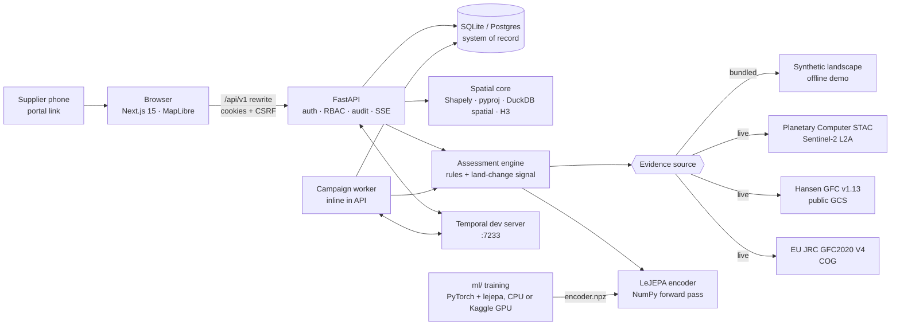

# Plotline: architecture

Constraints that shaped it: an 8 GB laptop, no Docker, no accounts, $0, fully offline by default, with
real public Earth-observation data available when online. Module boundaries and API shapes are in
[API_CONTRACT.md](API_CONTRACT.md); decisions in [adr/](adr/).

## Components

## Layers
| Layer | Responsibility | Tech |
|---|---|---|
| Web | Map-first app, supplier portal, landing | Next.js 15, TypeScript, Tailwind 4.1, MapLibre GL + OpenFreeMap |
| API | Auth, tenancy, RBAC, audit chain, validation, SSE, rate limits | FastAPI, SQLAlchemy 2 async, Alembic |
| Spatial | Geometry rules, parsing (GeoJSON/KML/CSV), geodesic area, overlaps, country plausibility, H3 index | Shapely 2, pyproj, DuckDB spatial, h3 |
| Evidence | Forest 2020, loss since 2021, imagery composites, clipped raster cache in `data/rasters/` | rasterio (live), NumPy |
| Assessment | Deterministic verdict rules + second signal + reproducibility hashes | NumPy |
| Change signal | Tiny CNN encoder (~0.45 M params) trained with LeJEPA (SIGReg); cosine change score; similar plots | PyTorch for training only; NumPy at runtime |
| Workflows | Supplier campaigns lasting weeks: requests, reminders, submissions, automated checks, human approval | Temporal (Python SDK), time-skipping tests |
| Documents | DDS payload (TRACES structure), HTML/PDF evidence pack, plain-language summary | fpdf2, offline text generator (LiteLLM optional) |

## Assessment flow
1. Geometry validated and normalised (6 decimals, closed CCW rings); points become a circle of the declared area.
2. Evidence source returns, on a 10 m grid around the plot: forest 2020 mask, loss year, tree cover 2000,
   baseline (2020) and current Sentinel-2 composites, and cloud-free share. Live mode clips and caches them
   under `data/rasters/`; bundled mode renders the synthetic landscape deterministically.
3. Official metrics: forest-2020 area inside the plot, loss area by year since 2021 on forest-2020 pixels.
4. Second signal: 32 × 32 patches over the plot embedded for 2020 and now; change score = cosine distance,
   levels from the threshold calibrated against Hansen in `ml/artifacts/eval.json`.
5. Rules (`eudr-rules-2026.1`) produce the verdict, reasons and `review_required`; dataset versions and hashes
   are stored with the append-only assessment.

## Campaign workflow
`SupplierCampaignWorkflow` fans out one child `SupplierEvidenceWorkflow` per supplier:
request (portal link + notification) → wait for the `submitted` signal with a timer per reminder interval →
reminders (then `overdue` after the due date) → automated assessment activity → wait for reviewer
`decision` signal → approved, or changes requested and back to waiting. Activities write the stage and a
timeline event to the database and publish an SSE event, so the UI works from the database even when the
workflow server is down; workflow ids equal campaign/member ids so restarts resume, not duplicate.

## Runtime modes
| Mode | Database | Evidence | Workflows | Text |
|---|---|---|---|---|
| Offline demo (default) | SQLite | bundled synthetic landscape | local `temporal server start-dev` | deterministic |
| Live data | SQLite or Postgres | Planetary Computer + Hansen + JRC (no account) | same | optional free-tier keys |
| Tests / CI | SQLite temp | bundled | Temporal time-skipping test server | deterministic |

## Security and compliance controls
argon2id, 15-minute access tokens with rotating refresh tokens (reuse revokes the family), double-submit CSRF,
per-IP and per-portal-token rate limits, strict security headers, RFC 7807 errors without internals,
org-scoped queries (404 across tenants), hash-chained per-org audit log with verification, minimised farmer data,
five-year retention by archiving, reproducible assessments with stored dataset versions.
